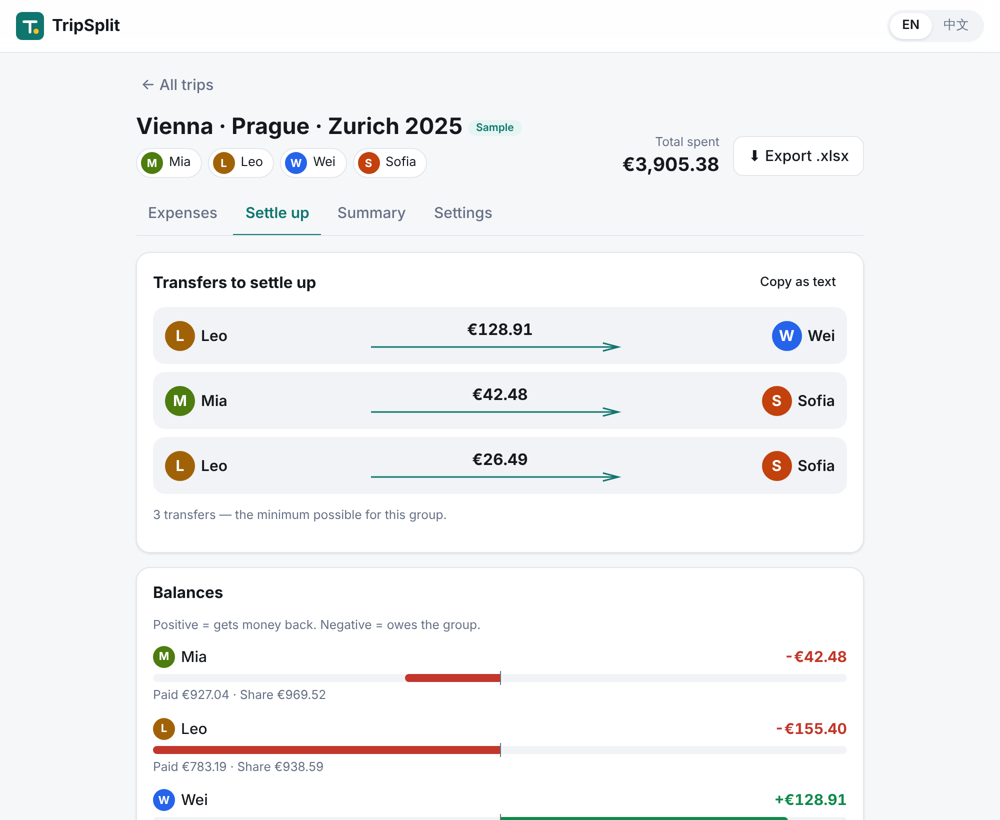
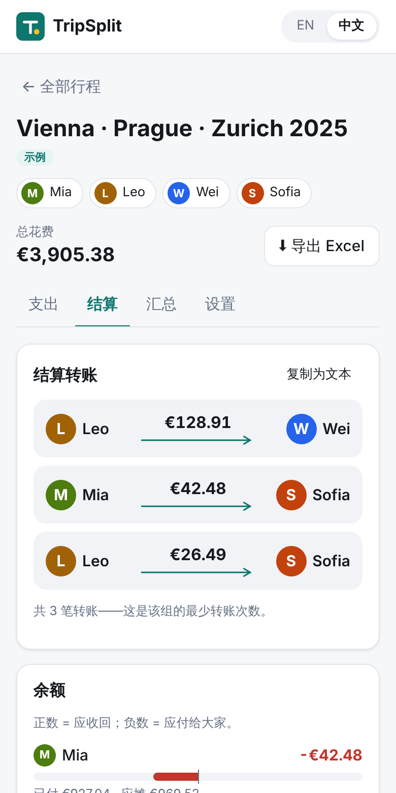

# TripSplit

**Split multi-currency trip expenses and settle up with the fewest transfers.**
TripSplit is a small web app for friends who travel together. Everyone logs what they paid, in whatever currency they paid it. TripSplit converts each expense at the official ECB rate for that day, splits it to the cent, and works out who should pay whom.

🔗 **Live demo:** https://sliu61.github.io/trip-split/. Click **"Try the sample Europe trip"** to load sample data instantly.





## Features

| | |
|---|---|
| **Trips** | Name, base currency (EUR, CHF, USD, CNY, … 31 ECB currencies), any number of members |
| **Expenses** | Description, amount, currency, date, payer, category (food / transport / lodging / tickets / other) |
| **Flexible splits** | Equal among selected people, custom **amounts**, or **shares** (e.g. 1.5× for a bigger room). Each person's share shows live while you type |
| **Exchange rates** | Fetched automatically from the free [Frankfurter API](https://www.frankfurter.app/) (ECB reference rates) for the expense date. You can override the rate on any expense, for example the cash rate from an airport kiosk |
| **Reproducible** | The rate used, its source and its ECB reference date are stored on each expense, so totals never move later |
| **Settle up** | Each member's balance in the base currency, plus the **minimum number of transfers** ("Leo pays Wei €128.91"). You can copy the list as text for a group chat |
| **Summary** | Totals by category, by member (paid vs. consumed) and by original currency, plus built-in **reconciliation checks** |
| **Excel export** | `.xlsx` with sheets **Expenses** (original amount, rate, base amount, per-member shares), **Balances**, **Settlement transfers**, **Summary** |
| **Bilingual** | English / 中文 toggle; the Excel headers follow the chosen language |
| **Private & offline-friendly** | No backend and no account. Data stays in your browser's `localStorage` |
| **Mobile-first** | Bottom-sheet forms, touch-sized controls, dark mode |

The **sample trip** has 4 friends on a Vienna → Prague → Zurich trip, with 18 expenses in EUR, CZK and CHF. It covers equal, amount-based and share-based splits, plus one manual exchange-rate override.

<br clear="right" />

## Run locally

Requires Node 20.19+ (22 recommended).

```bash
cd app
npm install
npm run dev        # http://localhost:5173
```

Other scripts (all from `app/`):

```bash
npm test           # Vitest unit tests (splitting, settlement, rounding, export, rates)
npm run build      # type-check + production build into app/dist
npm run preview    # serve the production build
```

### Deployment

`.github/workflows/deploy.yml` runs the tests and the build on every push and pull request. Pushes to `main` are deployed to GitHub Pages. One-time setup: **Settings → Pages → Build and deployment → Source: GitHub Actions**.

## Project structure

```
app/
  src/
    domain/              # pure, framework-free logic: all unit-tested
      money.ts           # minor units, rounding, currency formatting
      split.ts           # largest-remainder allocation, split validation
      settle.ts          # balances + minimum-transfer settlement
      rates.ts           # Frankfurter API client + cache
      summary.ts         # one report object used by the UI and the export
      export.ts          # workbook layout (pure) + SheetJS writer (lazy-loaded)
      sample.ts          # the demo trip
    i18n/                # EN / 中文 dictionaries
    components/          # React UI
    store.ts             # localStorage persistence + tiny hash router
```

## Design decisions

The brief left some points open. These are the choices I made, and why.

**Money is stored as integers.** All calculations use integer minor units (cents, haléř, Rappen), which avoids floating-point drift such as `0.1 + 0.2 ≠ 0.3`. Floats appear only at the edges, in user input and exchange rates. Currencies with no minor unit, such as JPY and ISK, are handled correctly.

**Each expense is converted first, then split.** The expense total is converted to the base currency and rounded **once**. That converted total is then divided among members. Converting each person's share separately could create or lose a cent, and the balances would no longer add up to zero.

**Rounding uses the largest-remainder method.** €10 split three ways gives €3.34 / €3.33 / €3.33. The shares always add up to exactly the total. Leftover cents go to the largest fractional remainders, and ties go to members in list order, so results are deterministic. Conversion uses round-half-away-from-zero, after cleaning up IEEE-754 noise.

**Custom amounts must match the total exactly.** In "Amounts" mode the form shows what is left to assign and won't save until it reaches zero. A mismatched split would be ambiguous. When the expense is in a foreign currency, the amounts are entered in that currency and then allocated proportionally in the base currency.

**The transfer count is truly minimal, not just "good enough".** Every app has to choose between optimal and greedy settlement. The minimum number of transfers is *(people with a non-zero balance) − (the largest number of disjoint sub-groups whose balances sum to zero)*. TripSplit finds that partition exactly with a bitmask DP for up to 16 people with non-zero balances, which covers almost any trip. Larger groups fall back to the classic greedy approach (largest debtor pays largest creditor, at most n−1 transfers). The tests compare the result against brute force on random cases, and include a case where greedy needs 4 transfers and TripSplit needs 3.

**Exchange rates:**
- Rates come from the ECB via Frankfurter. TripSplit always requests the EUR-based table for the date and derives cross rates itself (for example CZK→EUR = 1 / (CZK per EUR)). This avoids the extra rounding that Frankfurter applies to its own cross rates, which is noticeable for currencies like CZK.
- The ECB only publishes rates on business days, so a Sunday expense uses Friday's rate. The app shows and stores the reference date it actually used.
- Future dates use the latest available rate. Fetched tables for past dates are cached in `localStorage`, because historical rates never change.
- A rate is stored with 8 significant digits. A rate is fetched when an expense is created, and again when its date or currency changes. Editing anything else keeps the stored rate. You can refetch or override it at any time.
- If the API can't be reached (offline, ad-blocker), the form asks for a manual rate instead of blocking.

**The base currency is locked once a trip has expenses.** The stored rates are relative to the base currency. Changing it would silently invalidate them.

**Members can't be removed while they appear in an expense.** Removing them would break the history. They can still be renamed.

**The sample data is fixed.** The sample trip ships with stored rates, so it works offline and always gives the same numbers. These rates are snapshots of approximate ECB reference rates for June 2025, not live API responses, so they may differ slightly from the official figures. Open any expense and click **Refetch** to replace a rate with the live API value.

**Excel export:**
- Sheet names stay in English as specified. Column headers follow the UI language.
- Money cells are real numbers with currency number formats, not text, so recipients can keep calculating in Excel.
- SheetJS is lazy-loaded when you click Export, which keeps the initial page load small.
- The npm build of SheetJS (`xlsx@0.18.5`) is used because the SheetJS CDN wasn't reachable from the build environment. Its known advisories concern *parsing* untrusted files. TripSplit only *writes* files, so they don't apply here. Switching to the CDN tarball (`https://cdn.sheetjs.com/xlsx-0.20.3/xlsx-0.20.3.tgz`) is a one-line change in `package.json`.

**No router or UI library.** A tiny hash router (`#/trip/<id>/settle`) makes views linkable and lets the back button work. It also works on GitHub Pages without 404 tricks. Styles are hand-written CSS with light and dark themes. Only three runtime dependencies are used: React, ReactDOM and SheetJS.

**Language.** The first visit follows the browser language. After that, your choice is remembered.

## Testing

`npm test` runs 55 Vitest tests over the domain logic, including:

- **Rounding edge cases:** €10 ÷ 3, €0.01 ÷ 4, €0.05 ÷ 3, `1.005 × 100`, half-cent conversions, JPY↔EUR across different minor-unit counts, and tiny foreign expenses that round to €0.00
- **Property tests:** 2,000 random allocations always sum to the total, and each share is within 1 cent of its exact value. 300 random balance sets settle completely, with exactly the brute-force minimum number of transfers.
- **Settlement:** the greedy-vs-optimal counterexample, deterministic output, the large-group fallback, and rejection of balances that don't sum to zero
- **Validation:** custom amounts that don't add up, negative shares, missing participants, invalid rates
- **Rates:** cross-rate math, the weekend reference date, API errors (mocked `fetch`)
- **Export:** the four required sheets, per-member columns summing to each row's total, localized headers, a safe file name
- **Sample trip:** all reconciliation checks pass, and a balance snapshot guards against regressions

## Possible next steps

These ideas are not built yet. I'd evaluate each one with users before building it.

- Record a settlement as paid, so partial settle-ups are tracked over time
- Share a trip by link (needs a backend or CRDT sync). This is the biggest ask for real groups.
- Receipt photo capture and OCR for amounts
- Recurring split presets ("the usual 4 for dinner")
