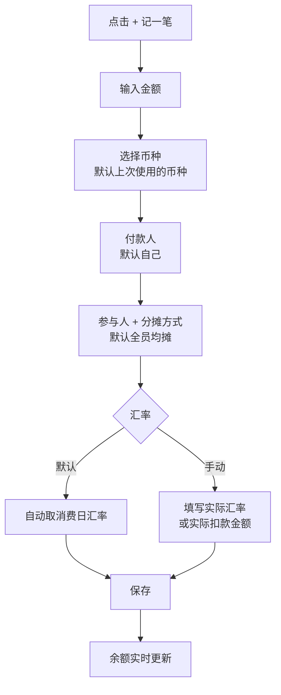
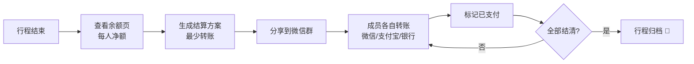

# TripSplit PRD — Multi-Currency Trip Expense Splitting

| 项目 | 内容 |
| --- | --- |
| 文档版本 | v1.0（MVP） |
| 作者 | 产品负责人（作品集项目） |
| 最后更新 | 2026-11-02 |
| 状态 | MVP 开发中 |
| 相关文档 | [竞品分析](./competitor-analysis.md) · [Roadmap](./roadmap.md) · [面试笔记](./interview-notes.md) |

---

## 1. Background & Problem

### 1.1 Background

- **出境游在快速恢复。** 文化和旅游部《2025年文化和旅游发展统计公报》显示，2025 年内地居民出境旅游 **1.48 亿人次，同比增长 20.8%**（[中新网, 2026-06-02](https://www.chinanews.com.cn/gn/2026/06-02/10633125.shtml)）。
- **留学生群体规模大，而且长期在海外生活。** 据新京报援引教育部留学服务中心消息，2025 年出国留学人数超过 **57 万**，英、美、澳仍是主要目的地（[新京报, 2026-04](https://m.bjnews.com.cn/detail/1775805773169004.html)）。
- **结伴出行是主流。** 毕业旅行、朋友自由行、家庭出境游、留学生假期穷游，都会产生大量"一人先付、事后分摊"的账。

### 1.2 Problem Statement

> 多人一起出境旅行时，消费分散在**多个币种、多个付款人、多种分摊方式**中。行程结束后，大家很难快速、准确、无争议地算清"谁该给谁转多少钱"。

具体痛点（来自桌面调研和竞品评论，详见[竞品分析](./competitor-analysis.md)；一手用户访谈见 §8 验证计划）：

| # | 痛点 | 现状做法 | 后果 |
| --- | --- | --- | --- |
| P1 | **多币种换算混乱**：同一趟欧洲行可能有 EUR、CHF、CZK，付款方式还有现金、信用卡、微信/支付宝境外支付 | Excel 手算，或者统一按某天的汇率粗略换算 | 汇率口径不一致，有人觉得吃亏；Splitwise 免费版里各币种余额分开显示，统一换算要付费 |
| P2 | **记账门槛高，经常漏记** | 群里发"我付了 xx"，事后翻聊天记录 | 漏记、重复记，月底对账要花 1 小时以上 |
| P3 | **分摊方式复杂**：有人不喝酒、有人没参加某个项目、房间按人头还是按间 | 只能均摊，或者手写备注 | 不公平感会伤感情 |
| P4 | **结算路径冗长**：6 个人互相欠钱，转账笔数多 | 两两轧差 | 转账次数多，有人漏转 |
| P5 | **工具不本土化**：海外产品需要注册海外账号、英文界面、无法在微信里打开；国内记账 App 以个人记账为主，AA 是附属功能 | 组织者自己记、截图发群 | 其他成员无法参与和核对，信任成本高 |

### 1.3 Why Now

1. 出境游和留学人数回升，跨币种 AA 的需求在增长（见 1.1）。
2. 头部海外竞品在**收紧免费功能**：Splitwise 对免费用户限制每日记账笔数，币种换算放在 Pro 里；Tricount 新版移除了 CSV/PDF 导出（见竞品分析）。用户对"免费、好用的多币种 AA"有空缺。
3. 大模型降低了**自然语言记账和票据识别**的成本，"一句话记一笔"在技术上可行（见 [Roadmap v2](./roadmap.md)）。

---

## 2. Goals & Non-Goals

### 2.1 Goals（MVP）

- G1：让一个 3–8 人的出境旅行小组在 **30 秒内创建行程并邀请成员**，**10 秒内记一笔多币种支出**。
- G2：行程结束时**一键给出最少转账笔数的结算方案**，金额以用户选定的结算币种显示，口径透明、可追溯。
- G3：**免费导出**完整账单（CSV），作为对比竞品的差异点和信任基础。

### 2.2 Non-Goals（MVP 明确不做）

| 不做 | 原因 |
| --- | --- |
| 站内支付或代收代付 | 涉及支付牌照和资金合规；MVP 只给出"谁转给谁多少"，转账让用户在微信/支付宝/银行里完成 |
| 个人日常记账、预算 | 聚焦"多人 + 多币种 + 行程"，避免和随手记这类综合记账产品正面竞争 |
| AI 功能（OCR、自然语言记账） | 放到 v2。先验证核心分账流程的留存，再用 AI 降低记账成本 |
| 原生 App | MVP 用 Web（移动端优先），通过链接分享，降低成员加入门槛 |

---

## 3. Target Users & Personas

### 3.1 Target Segments

| 细分人群 | 场景特征 | 优先级 |
| --- | --- | --- |
| **结伴出境游的年轻人**（22–35 岁） | 3–8 人，5–15 天，1–3 个币种，有明确组织者 | 🎯 核心 |
| **海外留学生** | 合租、周末短途游、跨国假期旅行，币种频繁切换，账期长 | 🎯 核心 |
| 家庭/亲友出境游 | 长辈不熟悉 App，通常一人代付 | 次要 |
| 商务差旅小组 | 有报销需求，需要正式导出 | 远期 |

### 3.2 Personas

#### Persona A：组织者 Olivia（毕业旅行"财务总管"）

- **画像**：24 岁，互联网公司运营，刚毕业一年。组织 6 人日本 + 韩国 10 日游。
- **行为**：习惯用 Excel 和微信群；行程里大部分大额支出（酒店、JR Pass、包车）由她先垫付。
- **痛点**：
  - 日元、韩元、人民币混在一起，"到底按哪天的汇率算"群里吵过一次；
  - 回国后花了一个晚上对账，还有人迟迟没转钱。
- **目标**："我只想让大家都觉得公平，并且尽快把钱收回来。"
- **成功标准**：回国 3 天内所有人结清，没有争议。

#### Persona B：留学生 Leo（长期多币种生活）

- **画像**：22 岁，英国读研。和 3 个室友合租，假期常去欧洲大陆旅行。
- **行为**：日常用 GBP；去法国、瑞士、捷克会遇到 EUR、CHF、CZK。外国同学也会一起出行。
- **痛点**：
  - 外国同学用 Splitwise，中国同学用微信群，两边都不方便；
  - Splitwise 免费版每天能记的笔数有限，统一换算要付费。
- **目标**："一个中英文都能用、不用下载、发链接就能加入的工具。"
- **成功标准**：混合国籍的小组也能顺畅使用；按 GBP 一次性结清。

#### Persona C：参与者 王叔叔（被动参与者）

- **画像**：52 岁，跟家人去欧洲跟团加自由行。
- **行为**：只会用微信，不愿意注册新 App。
- **痛点**：看不懂复杂的账，只想知道"我要给谁转多少"。
- **设计启示**：参与者**不注册、点开链接就能看到**自己该付多少；结算页要用大字号、写结论。

---

## 4. User Stories

> 格式：作为〈角色〉，我想要〈功能〉，以便〈价值〉。验收标准（AC）用于开发验收。

### Epic 1：Trip & Members（行程与成员）

| ID | User Story | 优先级 | 验收标准 |
| --- | --- | --- | --- |
| US-1.1 | 作为组织者，我想要快速创建一个行程，并设置**结算币种**（如 CNY），以便最后统一结算 | P0 | 只需填写行程名称和结算币种两个字段；创建后生成可分享链接 |
| US-1.2 | 作为组织者，我想要通过链接邀请成员，**成员无需注册**即可加入，以便降低参与门槛 | P0 | 打开链接后选择"我是谁"即可加入；可以通过微信转发链接 |
| US-1.3 | 作为组织者，我想要添加尚未加入的成员（占位成员），以便先记账、后认领 | P0 | 占位成员可以参与分摊；之后真实用户可以认领该身份 |
| US-1.4 | 作为成员，我想要切换中英文界面，以便和外国同学一起使用 | P1 | 中英文完整覆盖核心流程 |

### Epic 2：Expense Entry（记账）

| ID | User Story | 优先级 | 验收标准 |
| --- | --- | --- | --- |
| US-2.1 | 作为成员，我想要记一笔支出：金额、**原始币种**、付款人、参与人、日期、备注 | P0 | 默认付款人是自己，默认全员均摊；常见路径 ≤ 3 次点击 |
| US-2.2 | 作为成员，我想要系统**自动按消费当天的汇率**换算成结算币种，以便口径统一、可追溯 | P0 | 每笔支出保存汇率值、汇率日期和来源；页面上展示"1 EUR = 7.xx CNY（2026-10-01）" |
| US-2.3 | 作为付款人，我想要**手动覆盖汇率**（例如按信用卡账单的实际扣款汇率），以便更贴近实际花费 | P0 | 可以填写实际汇率，或直接填写实际扣款的结算币种金额；页面标记"手动汇率" |
| US-2.4 | 作为成员，我想要选择分摊方式：**均摊 / 按份数 / 按精确金额**，以便处理"有人不喝酒""房间按人头"等情况 | P0 | 精确金额模式下，校验各项之和等于总额；不平时阻止保存，并提示差额 |
| US-2.5 | 作为成员，我想要编辑或删除支出，并保留**变更记录**，以便解决争议 | P1 | 记录谁在什么时候改了什么 |
| US-2.6 | 作为成员，我想要给支出设置分类（餐饮、交通、住宿、门票、购物、其他） | P1 | 默认"其他"；可以按分类查看汇总 |
| US-2.7 | 作为成员，我想要上传票据照片作为凭证 | P2 | 单张 ≤ 5MB；v2 会接入 OCR |
| US-2.8 | 作为成员，我想要记录**收入或退款**（如押金退回、退税），以便冲减支出 | P2 | 退款用负向分摊处理 |

### Epic 3：Balances & Settlement（余额与结算）

| ID | User Story | 优先级 | 验收标准 |
| --- | --- | --- | --- |
| US-3.1 | 作为成员，我想要随时看到**每个人的净余额**（应收/应付），以便心里有数 | P0 | 所有人的净余额之和为 0（误差不超过最小货币单位，由舍入规则保证） |
| US-3.2 | 作为成员，我想要一键生成**最少转账笔数的结算方案** | P0 | 转账笔数 ≤ N−1（N 为余额非零的人数）；每笔显示"A → B ¥xxx" |
| US-3.3 | 作为成员，我想要把某一笔转账**标记为已支付** | P0 | 标记后余额实时更新；记录标记人和时间 |
| US-3.4 | 作为成员，我想要点击任意余额**下钻查看明细**（由哪些支出构成），以便自己核对 | P1 | 每个人的余额都能追溯到每一笔支出 |
| US-3.5 | 作为组织者，我想要把结算方案生成一张**可分享的图片或文字**发到微信群 | P1 | 一键复制文字，或生成图片 |
| US-3.6 | 作为成员，我想要更换结算币种（例如按 GBP 结算） | P2 | 按每笔支出原本锁定的汇率重算；不使用"今天的汇率"回溯 |

### Epic 4：Export（导出）

| ID | User Story | 优先级 | 验收标准 |
| --- | --- | --- | --- |
| US-4.1 | 作为组织者，我想要**免费导出 CSV**（含原币金额、汇率、结算币金额、分摊明细） | P0 | 用 Excel 或 WPS 打开不乱码（UTF-8 BOM） |
| US-4.2 | 作为成员，我想要导出 PDF 账单汇总 | P2 | 包含汇总、结算方案和明细 |

---

## 5. Core Features & Prioritization

### 5.1 Prioritization Framework

优先级的判断依据有三条：**(1) 是否属于"创建 → 记账 → 结算"主链路**；(2) 是否是相对竞品的差异点；(3) 开发成本。主链路的功能，以及有它才能体现差异的功能，定为 P0。

| 优先级 | 定义 |
| --- | --- |
| **P0** | 没有它，产品无法完成"一次多币种旅行从记账到结清"的闭环。MVP 必须上线 |
| **P1** | 显著提升体验或信任感，MVP 后 2–4 周内迭代 |
| **P2** | 锦上添花，或者需要数据验证后再做 |

### 5.2 Feature List

| 模块 | 功能 | 优先级 | 差异化说明 |
| --- | --- | --- | --- |
| 行程 | 创建行程、设置结算币种、分享链接 | P0 | — |
| 成员 | 链接加入、免注册、占位成员 | P0 | ✅ 比需要注册账号的海外竞品门槛低 |
| 记账 | 多币种支出（150+ ISO 4217 币种） | P0 | — |
| 汇率 | **按消费日锁定汇率** + 手动覆盖 | P0 | ✅ 核心差异：口径透明，事后不漂移 |
| 分摊 | 均摊 / 按份数 / 精确金额 | P0 | — |
| 结算 | 净余额 + 最少转账方案 + 标记已付 | P0 | — |
| 导出 | CSV 导出（免费） | P0 | ✅ Splitwise 和 Tricount 的导出受限（见竞品分析） |
| 双语 | 中 / 英界面 | P1 | ✅ 混合国籍小组 |
| 审计 | 变更记录 | P1 | 降低争议 |
| 分享 | 结算方案文字/图片分享到微信 | P1 | ✅ 本土化 |
| 分类 | 分类和分类汇总 | P1 | 为 v2 智能分类打基础 |
| 票据 | 照片附件 | P2 | 为 v2 OCR 打基础 |
| 退款 | 收入/退款 | P2 | — |
| 导出 | PDF | P2 | — |

### 5.3 Key Product Decisions（关键决策与取舍）

| 决策 | 选择 | 放弃的方案 | 理由 |
| --- | --- | --- | --- |
| 汇率口径 | **每笔支出锁定消费当日汇率**，可手动覆盖 | 结算时统一按"今日汇率"换算 | 汇率会波动。按今日汇率回溯，会让已发生的账"变动"，影响公平感。锁定后每个数字都可以追溯和复核 |
| 汇率数据源 | 每日参考汇率（如欧洲央行参考汇率或商业汇率 API），按日缓存 | 实时汇率 | 分账不需要分钟级精度。日汇率更稳定、成本低、可复现 |
| 结算算法 | 基于净余额的**贪心匹配**（最大债权人对最大债务人），保证 ≤ N−1 笔 | 求全局最少笔数的精确解 | 精确求最少笔数是 NP-hard 问题。贪心算法在旅行小组规模（≤ 20 人）下结果接近最优、可解释、性能稳定 |
| 金额精度 | 以**最小货币单位整数**存储（分、日元无小数）；余数按确定性规则分配 | 浮点数 | 避免 0.1 + 0.2 ≠ 0.3 这类误差；确保余额之和严格为 0 |
| 身份体系 | 链接加入 + 本地身份，账号体系后置 | 强制注册登录 | 让参与者（Persona C）零门槛。代价是安全性较弱：链接泄露风险通过"可重置链接"缓解 |
| 平台 | 移动端优先的 Web | 原生 App / 微信小程序 | 开发最快，可跨端分享；验证需求后再评估小程序 |

---

## 6. Key User Flows

### 6.1 Flow 1：创建行程并邀请成员

### 6.2 Flow 2：记一笔多币种支出

**交互要点：**

- 币种默认取"本行程上次使用的币种"，旅途中连续记账基本不用切换。
- 保存前实时预览"≈ ¥xxx（汇率 x.xx，日期）"，用户在保存前就能确认口径。

### 6.3 Flow 3：结算

### 6.4 Calculation Example（计算示例）

3 人去瑞士和法国，结算币种为 CNY（汇率为示意数据）：

| 支出 | 原币 | 消费日汇率 | 结算币 | 付款人 | 分摊 |
| --- | --- | --- | --- | --- | --- |
| 酒店 | 600 CHF | 8.90 | ¥5,340.00 | A | A/B/C 均摊 |
| 晚餐 | 120 EUR | 7.80 | ¥936.00 | B | A/B 均摊（C 没参加） |
| 火车票 | 90 EUR | 7.82 | ¥703.80 | C | A/B/C 均摊 |

各人净额：A = +5340 − 1780 − 468 − 234.60 = **+2857.40**；B = +936 − 1780 − 468 − 234.60 = **−1546.60**；C = +703.80 − 1780 − 234.60 = **−1310.80**；合计为 0 ✅

结算方案（2 笔，即 N−1）：**B → A ¥1,546.60；C → A ¥1,310.80**

---

## 7. Success Metrics

### 7.1 North Star Metric

> **每周完成结清的行程数（Weekly Settled Trips）**
>
> 定义：当周内所有成员余额都归零（全部转账被标记为已付）、且成员数 ≥ 2、支出数 ≥ 3 的行程数量。

**为什么选它：** 它同时反映了**拉新**（行程被创建）、**协作**（多人参与）、**记账深度**（有足够支出）和**核心价值兑现**（算清并结清）。只看 DAU 或记账笔数，可能会被"记了但没用来结算"的行为虚高。

### 7.2 Metric Tree

| 漏斗阶段 | 指标 | MVP 目标（假设值，待验证） |
| --- | --- | --- |
| Acquisition | 新建行程数 / 周 | 冷启动期以绝对值观察 |
| Activation | 创建后 24h 内，≥2 名成员加入且 ≥3 笔支出的行程占比 | ≥ 40% |
| Collaboration | 邀请链接打开 → 加入的转化率 | ≥ 60% |
| Collaboration | 非组织者记账的占比 | ≥ 30%（衡量是否只有组织者在用） |
| Engagement | 记一笔的中位耗时 | ≤ 10 秒 |
| Value | 行程结算完成率（生成方案后 14 天内结清） | ≥ 50% |
| Retention | 组织者 90 天内创建第二个行程的比例 | ≥ 20% |
| Referral | 参与者后续自己作为组织者创建行程的比例 | 观察指标（衡量病毒传播） |

### 7.3 Guardrail Metrics（护栏指标）

| 指标 | 意义 |
| --- | --- |
| 结算后支出被修改的比例 | 太高说明存在争议或记账错误 |
| 手动覆盖汇率的比例 | 太高可能说明默认汇率不可信，需要换数据源或改展示方式 |
| 精确金额分摊校验失败率 | 衡量分摊交互的易用性 |
| 余额计算误差 | 必须为 0（自动化测试保障） |

### 7.4 Instrumentation（埋点）

核心事件：`trip_created`、`member_joined`、`expense_added`（属性：currency、split_type、fx_overridden、duration_ms）、`settlement_viewed`、`transfer_marked_paid`、`trip_settled`、`export_clicked`。

---

## 8. Assumptions & Validation Plan

| 假设 | 风险 | 验证方式 |
| --- | --- | --- |
| H1：多币种汇率口径是用户的真实痛点，而不只是"麻烦" | 高 | 访谈 8–10 位近一年有结伴出境游经历的用户和留学生；验证信号是"曾因汇率口径产生分歧" |
| H2：免注册加入能显著提升成员参与率 | 中 | 对比加入转化率（目标 ≥ 60%）；必要时 A/B 测试"需要注册"的版本 |
| H3：用户愿意在旅途中实时记账，而不是事后补记 | 高 | 观察 expense_added 的时间分布（行程中 vs 行程后）；如果以事后补记为主，就提高 v2 OCR 和批量导入的优先级 |
| H4：免费导出是有效的差异点 | 低 | 观察 export_clicked 的使用率，以及访谈中提及的频率 |

---

## 9. Risks & Mitigations

| 风险 | 缓解措施 |
| --- | --- |
| 汇率 API 不可用或数据缺失 | 按日缓存；缺失时回退到最近可用日期并标注；始终允许手动覆盖 |
| 分享链接泄露导致账目被篡改 | 变更记录 + 组织者可重置链接；v1.x 增加可选的登录保护 |
| 舍入导致余额和不为 0 | 整数存储 + 确定性余数分配 + 单元测试覆盖 |
| 冷启动难 | 单个行程天然具有多人传播属性（一个组织者带来 3–8 个用户）；在留学生社群和小红书做内容冷启动 |
| 个人信息合规 | 只收集昵称；不收集手机号和身份证；票据图片（v2）需要明确告知并获得授权，遵循《个人信息保护法》最小必要原则 |

---

## 10. Appendix

### 10.1 Glossary

| 术语 | 定义 |
| --- | --- |
| 原始币种 | 实际消费时使用的币种（如 EUR） |
| 结算币种 | 行程最终用于结算的币种（如 CNY），由组织者设定 |
| 净余额 | 某成员"已付总额 − 应承担总额"，正数表示应收，负数表示应付 |
| 锁定汇率 | 记账时按消费日期确定并保存的汇率，之后不再随市场变化 |

### 10.2 Data Sources

- 文化和旅游部《2025年文化和旅游发展统计公报》，转引自[中新网](https://www.chinanews.com.cn/gn/2026/06-02/10633125.shtml)
- 教育部留学服务中心，转引自[新京报](https://m.bjnews.com.cn/detail/1775805773169004.html)
- 竞品信息见 [competitor-analysis.md](./competitor-analysis.md)
