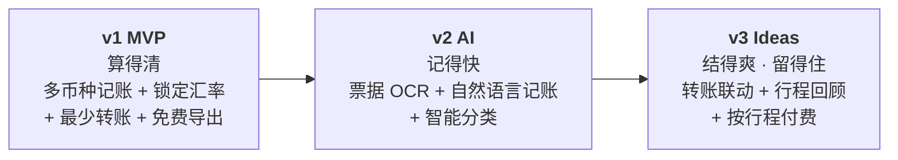

# TripSplit Roadmap — From MVP to AI-Native Expense Splitting

| 项目 | 内容 |
| --- | --- |
| 最后更新 | 2026-11-02 |
| 相关文档 | [PRD](./PRD.md) · [竞品分析](./competitor-analysis.md) · [面试笔记](./interview-notes.md) |

---

## 1. Overview



| 阶段 | 主题 | 要解决的核心问题 | 进入下一阶段的门槛（Exit Criteria） |
| --- | --- | --- | --- |
| **v1 MVP** | 算得清 | 多币种、多付款人的账算不清、口径有争议 | 激活率 ≥ 40%，结算完成率 ≥ 50%；访谈中"汇率口径"痛点得到确认 |
| **v2 AI** | 记得快 | 旅途中记账麻烦，导致漏记和事后补记 | AI 记账采纳率 ≥ 30%，AI 记账笔数中"无需修改直接保存"的比例 ≥ 80% |
| **v3** | 结得爽 · 留得住 | 结算后的转账摩擦；行程低频导致留存差 | 视 v2 数据决定 |

**排序逻辑：** 先做 v1 而不是直接上 AI，是因为 **AI 只是降低记账成本的手段**，前提是"记了账能算清"这个核心价值成立。如果用户连结算功能都不用，AI 记账做得再好也只会放大一个没人要的流程。

---

## 2. v1 — MVP: Get the Math Right

> 详细需求见 [PRD](./PRD.md)。

| 能力 | 说明 |
| --- | --- |
| 行程与成员 | 创建行程、设置结算币种、链接邀请、免注册加入、占位成员 |
| 多币种记账 | 150+ 币种；**按消费日锁定汇率**，可手动覆盖 |
| 灵活分摊 | 均摊 / 按份数 / 精确金额 |
| 结算 | 净余额、最少转账方案（≤ N−1 笔）、标记已付 |
| 导出 | 免费 CSV |
| v1.x 迭代 | 中英双语、变更记录、结算方案分享到微信、分类汇总 |

**v1 刻意为 v2 打的基础：**
- 支出数据结构里预留 `source` 字段（`manual` / `ocr` / `nlp`），用于衡量 AI 记账的效果。
- 分类字段从 v1 开始收集用户的手动选择，作为 v2 智能分类的**冷启动标注数据**。
- 票据照片附件（P2）为 OCR 积累真实样本（需用户授权）。

---

## 3. v2 — AI Features: Make Entry Effortless

### 3.0 Why AI, and Why Here

旅行记账的最大流失点是**"记账"这个动作本身**：在餐厅门口、在车上、在排队时，掏出手机填 5 个字段很反人性。AI 在这里的价值很清晰：**把"填表"变成"拍一张照"或"说一句话"**，同时把结构化工作交给模型。

**AI 功能的共同设计原则：**

1. **AI 填表，人确认（Human-in-the-loop）。** 涉及钱的数据，AI 永远只生成**草稿**，由用户一键确认后才入账，绝不静默写入。
2. **可解释、可修改。** 每个 AI 填写的字段都可以单独修改；低置信度字段高亮提示。
3. **可降级。** AI 失败、超时或离线时，平滑回退到手动表单，并保留已识别的部分。
4. **可度量。** 每个 AI 功能上线前，先建立离线评测集和线上指标。

---

### 3.1 Receipt OCR（票据识别）

**用户故事：** 作为付款人，我想拍一张小票，系统自动填好金额、币种、日期、商户和分类，以便 3 秒内完成记账。

| 维度 | 内容 |
| --- | --- |
| **用户价值** | ① 记账从约 10 秒 / 5 个字段降到"拍照 + 确认"；② 外文小票（德语、日语、法语）也能识别，降低语言门槛；③ 支持**逐项拆分**："这瓶酒只有 A 和 B 喝了"；④ 票据本身就是凭证，减少争议 |
| **技术方案** | **方案 A（首选）：多模态大模型直接抽取。** 图片 → 多模态 LLM + 结构化输出（JSON Schema：`merchant`、`total`、`currency`、`date`、`items[]`、`tax`、`tip`）。优点是对版式和多语言泛化好，开发快。<br/>**方案 B（备选/降本）：OCR 引擎 + LLM 结构化。** 先用通用 OCR 提取文本和坐标，再让文本 LLM 做字段抽取。优点是成本更低，可以替换为端侧 OCR。<br/>**后处理校验（关键）：** ① `sum(items) + tax + tip ≈ total` 的一致性校验；② 币种推断：小票上的币种符号 + 商户所在国 + 行程目的地，交叉验证（"$"可能是 USD/CAD/AUD，"¥"可能是 JPY/CNY）；③ 日期合理性检查（应落在行程日期范围内）；④ 校验失败的字段标记为低置信度。<br/>**交互：** 识别结果以"草稿卡片"展示，默认按行程的分摊习惯预填参与人；用户确认后入账。 |
| **风险** | ① **金额识别错误**：涉及钱，错一次就伤信任。→ 强制确认 + 一致性校验 + 低置信度高亮。② **币种歧义**（$ 和 ¥）。→ 结合行程上下文推断，不确定时让用户选择。③ **隐私**：小票可能包含卡号后四位、姓名、地址。→ 明确授权；只把必要内容发给模型服务；设定保存期限，用户可以删除；遵循《个人信息保护法》最小必要原则，评估跨境传输合规。④ **成本**：多模态调用单价较高。→ 压缩图片、按需调用、高频用户限额，评估方案 B。⑤ **境外网络差、延迟高**。→ 本地排队、联网后识别；先保存照片，稍后补全。 |
| **成功度量** | **离线（上线前）：** 自建评测集 ≥ 300 张，覆盖 ≥ 8 个国家和语言（含手写、热敏纸褪色、折痕）；`total` 字段准确率 ≥ 95%，`currency` ≥ 97%，`date` ≥ 95%，逐项拆分行级 F1 ≥ 0.85。<br/>**线上：** ① **采纳率**：OCR 记账笔数 / 总记账笔数；② **免修改率**：AI 草稿未经修改直接保存的比例（核心质量指标，目标 ≥ 80%）；③ 字段级修改率：哪个字段最常被改，指导优化方向；④ 记一笔的中位耗时（对比手动）；⑤ 单次识别成本和 P90 延迟（目标 ≤ 5 秒）。<br/>**护栏：** 金额字段被修改的比例；OCR 记账的支出在结算后被修改的比例。 |

---

### 3.2 Natural-Language Entry（自然语言记账）

**用户故事：** 作为成员，我想输入或说一句"晚饭86欧，我和小王平摊"，系统自动生成一笔结构化的支出，以便不用逐个点选字段。

**解析示例：**

```text
输入：晚饭86欧，我和小王平摊
```

```json
{
  "description": "晚饭",
  "category": "餐饮",
  "amount": 86.00,
  "currency": "EUR",
  "payer": "me",
  "participants": ["me", "member_xiaowang"],
  "split": { "type": "equal" },
  "date": "2026-11-02",
  "confidence": { "amount": 0.99, "currency": 0.97, "participants": 0.92 }
}
```

**更多需要覆盖的表达：**

| 输入 | 难点 |
| --- | --- |
| "昨天打车 2300 日元，Olivia 付的，大家平摊" | 相对日期、他人付款、"大家" = 全员 |
| "酒店三晚 450 镑，我付的，按房间：我和Leo一间，小王一间" | 非均摊、按份数推理 |
| "午饭 60，小王没吃" | 省略币种（用行程上次使用的币种）、排除某人 |
| "门票每人 25 欧，我先垫了 4 个人的" | "每人"乘法、总额 = 100 |
| "86块" | "块"在不同语境下可能指 CNY、EUR 或当地货币，有歧义 |

| 维度 | 内容 |
| --- | --- |
| **用户价值** | ① 符合中文用户在群里说"我付了xx"的习惯，学习成本几乎为零；② 一句话完成 5 个字段，适合边走边记；③ 结合语音输入（系统键盘自带），可以单手操作；④ **差异化**：海外竞品对中文自然语言、昵称和口语化表达的理解是短板 |
| **技术方案** | **LLM + 结构化输出（Function Calling / JSON Schema）。** ① **上下文注入**：Prompt 中带入行程成员列表（含昵称和别名，如"小王"、"王哥"、"Wang"）、当前用户、行程目的地和常用币种、今天日期；② **Schema 约束**：输出严格遵循支出 Schema，币种限定为 ISO 4217 枚举，成员限定为本行程成员 ID；③ **实体消解**：模型输出的人名映射到成员 ID，匹配不到时**不臆造**，返回 `unresolved` 让用户选择；④ **确定性计算放在代码里**：模型只负责"理解意图"（谁付、谁参与、什么分法），**金额拆分、乘法和舍入由后端代码完成**，避免 LLM 算术错误；⑤ **草稿确认卡片**：显示解析结果，低置信度字段高亮。<br/>**模型选型：** 意图解析是短文本任务，优先选小而快的模型以控制延迟和成本；复杂句（多人、多分摊规则）路由到更强的模型。<br/>**评测集：** 收集 ≥ 500 条真实风格的口语句子（覆盖上表的难点和中英混杂），标注标准答案，用于回归测试和模型、Prompt 迭代。 |
| **风险** | ① **幻觉**：模型编造不存在的成员或金额。→ Schema 枚举约束 + 实体消解失败时让用户选择 + 必须确认。② **歧义**（"86块"是什么币种，"大家"是否包含不在场的人）。→ 用行程上下文给出默认值，同时在卡片上显式展示，让用户一眼能发现错误。③ **算术错误**。→ 所有计算交给代码，LLM 不做数学。④ **Prompt 注入**（备注里写入恶意指令）。→ 用户输入只作为数据处理；输出只能是 Schema 内的字段，不能触发其他操作。⑤ **成本和延迟**。→ 小模型优先、缓存成员上下文、P90 延迟目标 ≤ 2 秒。 |
| **成功度量** | **离线：** 整句完全正确率（所有字段都对）≥ 85%；金额准确率 ≥ 98%；参与人集合准确率 ≥ 90%；`unresolved` 时没有臆造的比例 = 100%。<br/>**线上：** ① 采纳率（NL 记账占比）；② 免修改率 ≥ 80%；③ 字段级修改分布；④ 记一笔中位耗时；⑤ 使用 NL 记账的用户中，非组织者的占比（衡量是否降低了"其他成员"的记账门槛）。<br/>**护栏：** 金额被修改的比例；NL 记账生成的支出被删除的比例。 |

---

### 3.3 Smart Categorization（智能分类）

**用户故事：** 作为成员，我希望系统自动给每笔支出打上分类（餐饮、交通、住宿、门票、购物），以便行程结束后看到"我们在吃上花了多少"，而不用手动选择。

| 维度 | 内容 |
| --- | --- |
| **用户价值** | ① 记账少填一个字段；② 生成行程消费结构（如"住宿 42%、餐饮 28%"），为行程回顾和预算提供数据；③ 为 v3 的行程回顾、下次旅行预算建议提供结构化数据 |
| **技术方案** | **分层策略，由便宜到昂贵：** ① **规则和词典**：高频关键词（"晚饭"、"taxi"、"Uber"、"Hotel"、"地铁"）直接命中，零成本、零延迟；② **复用上游结果**：OCR 和 NL 记账时让 LLM 顺带输出分类，不额外调用；③ **轻量模型或向量相似度**：基于商户名和描述的 Embedding，匹配历史已分类支出；④ **个性化纠错**：用户修改分类后，作为该行程的偏好（如"Lidl"在这个行程中都记为"日用"）。<br/>**冷启动：** 使用 v1 收集的用户手动分类作为训练和评测数据。 |
| **风险** | ① 分类错误影响统计的可信度。→ 分类错误的代价比金额错误低得多，所以可以**自动应用、事后可改**（与金额的强确认不同）。② 分类体系过细，导致准确率下降和用户困惑。→ 固定 6–8 个一级分类。③ 过度工程化。→ 先用规则和复用 LLM 输出，数据证明有必要再上专门模型。 |
| **成功度量** | ① 自动分类准确率（以用户未修改为代理指标）≥ 85%；② 用户手动修改分类的比例逐月下降；③ "未分类/其他"占比 ≤ 10%；④ 分类汇总页的访问率（间接衡量价值） |

---

### 3.4 v2 Prioritization

| 功能 | Reach | Impact | Confidence | Effort | 排序 |
| --- | --- | --- | --- | --- | --- |
| 自然语言记账 | 高（所有记账场景） | 高 | 中（中文口语解析难度可控） | 中 | **1** |
| 智能分类 | 高 | 低–中 | 高 | 低（大部分复用） | **2**（和 NL 一起上线） |
| 票据 OCR | 中（有小票的场景） | 高 | 中（外文小票、褪色票据难度大） | 中–高 | **3** |

**为什么 NL 记账排在 OCR 前面：**
1. 覆盖面更广：很多旅行支出没有小票（打车、街边摊、门票二维码）。
2. 纯文本调用成本和延迟更低。
3. 评测集更容易构建。
4. 是中文场景的差异点，海外竞品在这方面相对薄弱。

### 3.5 AI Cost Model（成本预估思路）

- **单笔成本** = 平均 token 数 × 单价 + （OCR 时）图片 token。
- **单趟行程 AI 成本** = 每趟平均记账笔数 × AI 记账占比 × 单笔成本。
- 用于判断：免费额度设多少？是否需要"按行程解锁"的付费墙？（见 v3 商业化）
- 上线后监控：单趟行程 AI 成本、P90 延迟、失败率。

---

## 4. v3 — Ideas: Settle Faster, Come Back Again

> v3 是待验证的方向池，不承诺上线。每个方向都标注了需要验证的关键假设。

| 方向 | 描述 | 用户价值 | 关键假设 / 风险 |
| --- | --- | --- | --- |
| **转账联动** | 结算方案一键跳转到微信或支付宝转账，或生成收款码；对接群收款 | 消除"算清了但没转"的最后一公里 | 平台接口开放程度、合规（不碰资金流） |
| **实际扣款汇率对账** | 导入信用卡账单（截图 OCR / CSV），用实际扣款金额自动校正记账时的估算汇率 | 账更"真"，消除手续费和汇率差的争议 | 用户是否在意几十元的差异；账单格式多样 |
| **AI 行程问答** | "我们在吃上花了多少？""小王一共付了多少？"——基于行程账本的自然语言问答 | 降低查账门槛，特别适合长辈（Persona C） | 需要可靠的 Text-to-Query，避免数字幻觉（答案必须由查询计算得出） |
| **行程回顾卡片** | 行程结束后生成可分享的"旅行账单回顾"（总花费、人均、消费结构、最贵的一顿饭） | 情感价值 + **社交裂变**（分享到朋友圈或小红书带来新用户） | 用户是否愿意公开消费信息 → 默认隐藏金额，可选择展示 |
| **预算与公共钱包** | 出发前设预算、预收"公共基金"，按基金余额实时提醒 | 从"事后算账"延伸到"事前规划" | 和"不做个人记账"的定位边界 |
| **微信小程序** | 小程序版本，原生支持群内分享和群身份 | 进一步降低参与门槛 | 开发和审核成本；需要 v1/v2 数据证明 Web 链接是瓶颈 |
| **离线模式** | 无网络时可记账，联网后同步 | 境外流量或网络差的场景 | 冲突合并的复杂度 |
| **按行程付费（商业化）** | 免费版覆盖核心分账；"高级行程包"（无限 AI 记账、PDF 报告、实际汇率对账）按行程一次性付费，由组织者购买 | 和旅行的低频特征匹配，比订阅更容易接受 | 参考 Settle Up 的 Group Premium；需要验证付费意愿和价格点 |
| **B2B 合作** | 和留学服务机构、旅行社、出境卡类金融产品合作 | 获客渠道；参考 Tricount 作为银行获客入口的模式 | 偏离 C 端体验的风险 |

---

## 5. Release Principles

1. **每个版本都有 Exit Criteria**，数据不达标就先迭代，不盲目推进下一阶段。
2. **AI 功能灰度上线**：先面向 10% 的用户 → 观察免修改率和护栏指标 → 再全量。
3. **涉及钱的 AI 输出必须经过人确认**，这条原则在任何版本都不让步。
4. **评测集先于功能**：任何 AI 功能，先有离线评测集和通过线，再有上线计划。
